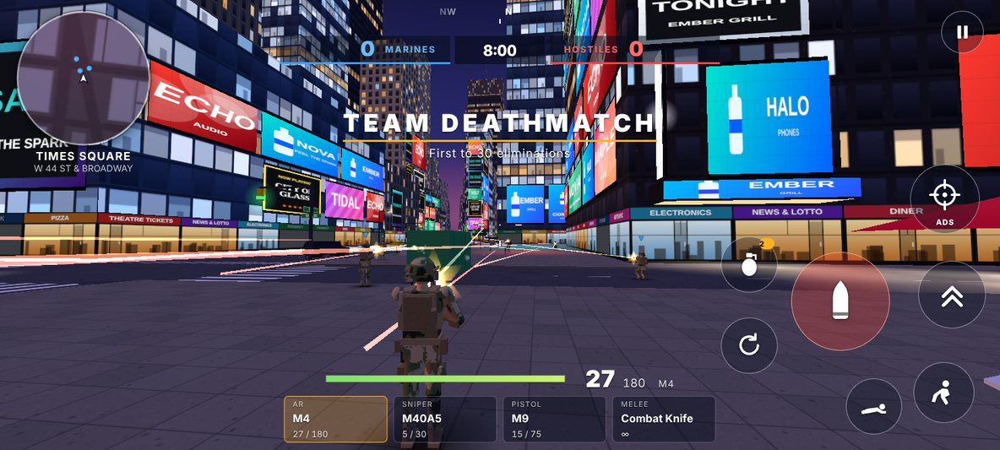
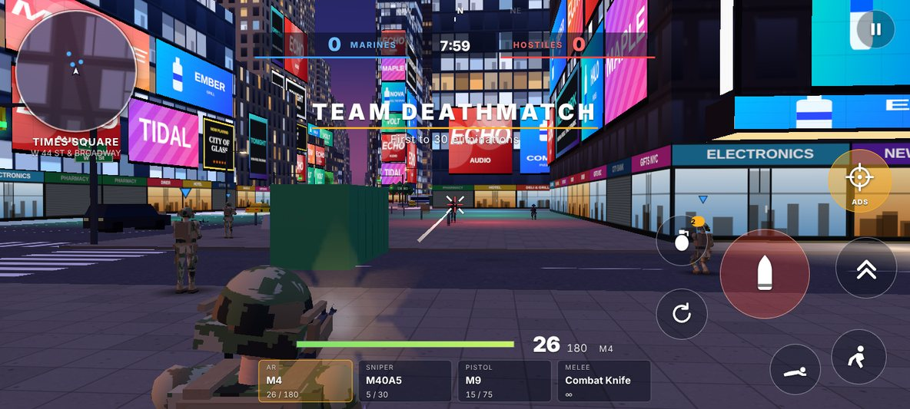
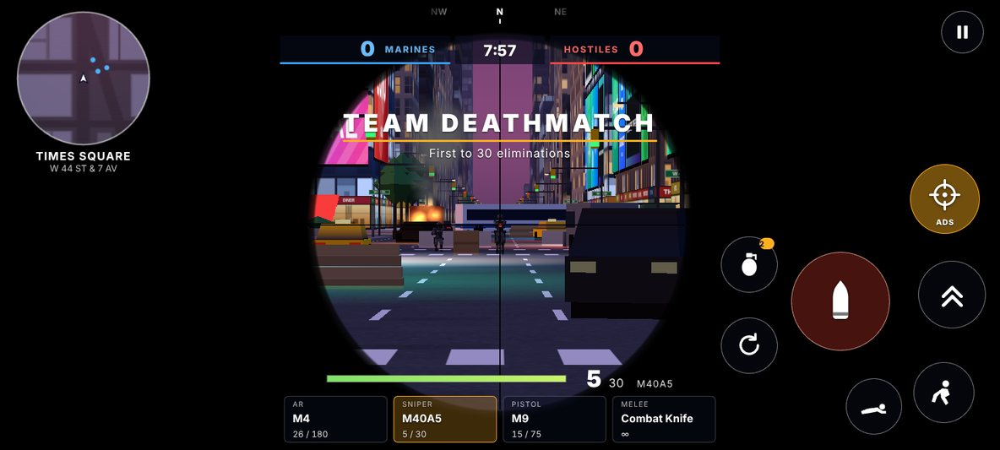
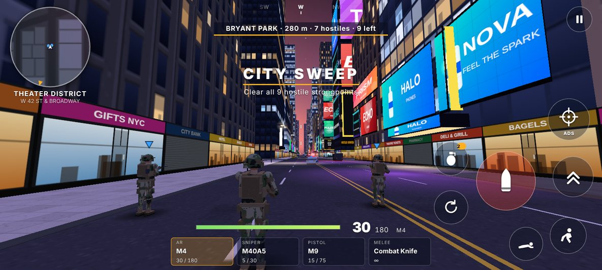
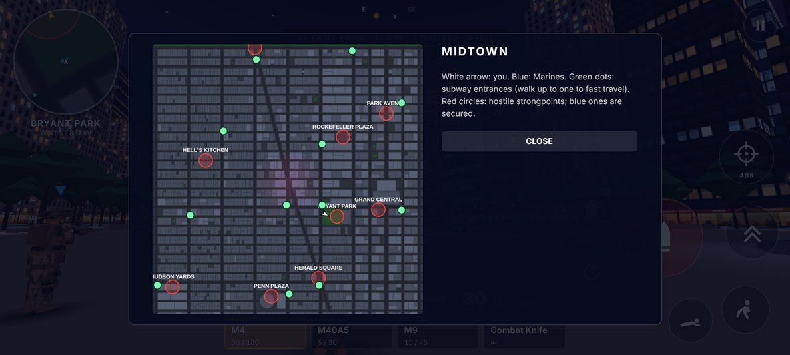

# Midtown Strike

A third-person shooter for Android phones and for Mac. You play a US Marine fighting through a
2-square-mile recreation of Midtown Manhattan built around Times Square.

It is an original game with the feel of a modern mobile military shooter: the movement,
gunplay and touch controls follow the conventions of the genre, while the name, art,
map and code are its own.



## Install on your phone

1. Copy **[`dist/MidtownStrike.apk`](dist/MidtownStrike.apk)** to the phone (or download it there).
2. Open it. Android asks to allow installs from that app ("unknown sources") — allow, then **Install**.
3. Play Protect may warn that it does not recognise the developer, because the APK is signed
   with this project's own key rather than a Play Store one. Choose **Install anyway**.

Requirements: Android 7.0 or newer, OpenGL ES 3.0. The game is 250 KB, needs no permissions
and no network: every texture, model and sound is generated on the device at start-up.

## Install on a Mac

1. Download **[`dist/MidtownStrike-mac.zip`](dist/MidtownStrike-mac.zip)** and double-click it. You get **Midtown Strike.app**.
2. Drag it into **Applications** (optional) and open it.
3. The first time, macOS says it cannot verify the app, because it is not signed with an Apple
   developer certificate. Click **Done**, open **System Settings → Privacy & Security**, scroll down
   and click **Open Anyway**. On macOS 14 or older, right-click the app and choose **Open** instead.

The app opens the game in its own window when Chrome, Edge or Brave is installed, and in your
default browser (Safari) otherwise. Click **PLAY**; the mouse is captured for aiming and **Esc**
releases it and pauses. Use the **FULL SCREEN** button in the menu for the best view.

If macOS will not open the app at all, right-click it, choose **Show Package Contents**, and open
`Contents/Resources/game/index.html` in Chrome or Safari: that single file is the whole game.

Keys: WASD move, Shift sprint, Space jump, C crouch, Z prone, mouse or trackpad to aim, click to
fire, right click (two-finger click) or X for sights, R reload, 1–4 or scroll to change weapon,
G grenade, F interact, M map. On a trackpad, *Fire mode: Auto* in Settings is easier.

## What is in the game

| | |
|---|---|
|  |  |
|  |  |

**The map — 2300 m × 2300 m (2.04 sq mi) of Midtown**

- The real street plan: 31st to 59th Street, 11th to 3rd Avenue, Broadway cutting the grid
  diagonally from Herald Square to Columbus Circle and forming the Times Square "bowtie"
  where it crosses 7th Avenue.
- Times Square itself: walls of animated billboards (all brands invented), the narrow
  tower with its screen stack, news ticker and New Year's ball, the red steps, theatre
  marquees, pedestrian plazas, yellow cabs.
- Landmarks to navigate by: Bryant Park and the library, Grand Central, Rockefeller Plaza
  with its rink and tree, an Empire-style and a Chrysler-style spire, the arena at Penn
  Plaza, the pencil towers on 57th, Columbus Circle, the edge of Central Park and the
  Hudson waterfront.
- About 2,600 buildings, 1,700 vehicles and 9,400 collision volumes, generated from a
  fixed seed so the city is identical on every device.

**The Marine** — woodland MARPAT utilities, coyote plate carrier and boots, helmet with
camouflage cover, flag patch and "U.S. MARINES" tape. One skinned mesh, animated in code:
run and strafe cycles, crouch, prone, slide, jump, two-handed weapon handling with arm IK,
reloads, melee swings, hit reactions and falls.

**Weapons** — one from each class in every loadout, chosen in the menu:

| Class | Weapons |
|---|---|
| Assault rifle | M4 (auto), AK-47 (auto), M16 (3-round burst) |
| Sniper rifle | M40A5 (bolt action), M107 .50 (semi-auto) |
| Handgun | M9, .50 GS |
| Melee | Combat Knife, Tomahawk |

plus frag grenades that bounce and roll.

**Mechanics**

- Movement: walk, sprint, crouch, prone, slide (crouch while sprinting), jump, and
  mantling over cars, barriers and crates.
- Gunplay: hitscan ballistics with damage drop-off over range, head / torso / limb
  multipliers, hip-fire spread that blooms with movement and sustained fire, aim-down-sights
  with per-weapon timing and zoom, recoil that climbs and settles, magazines and reserves,
  timed reloads, scoped sniping, melee lunge.
- Health regenerates out of combat; eliminations top up ammunition.
- Aim assist and an optional auto-fire ("simple") mode for touch play.
- Bots with sight cones, hearing, reaction times, burst fire and strafing, pathfinding
  over a street graph, snipers and knife rushers. Four difficulty levels.

**Modes**

- **Team Deathmatch** — 6 v 6 in the Times Square bowtie, first to 30.
- **City Sweep** — open world. Lead a fire team across the whole map and clear nine hostile
  strongpoints. Subway entrances are fast travel and resupply.

## Controls

Touch: drag on the left half to move (push past the ring to sprint), drag on the right half
to look, hold the red button to fire (keep dragging on it to track). Buttons for ADS, jump,
crouch, prone, reload and grenade; tap a weapon slot to switch; tap the minimap for the full map.

In a desktop browser: WASD, Shift sprint, Space jump, C crouch, Z prone, mouse to aim and fire,
right mouse ADS, R reload, 1–4 weapons, G grenade, F interact, M map, Esc pause.

## Building

The game is plain JavaScript on [three.js](https://threejs.org), bundled into one HTML file
that the Android app shows in a full-screen WebView.

```bash
npm install
npm run build        # -> android/app/src/main/assets/game/index.html
npm run dev          # rebuild on change, http://localhost:8080
```

`index.html` is self-contained: opening it in Chrome is the quickest way to try a change.

There are two ways to turn it into an APK.

**Without the Android SDK** (how `dist/MidtownStrike.apk` was built):

```bash
(cd android/tools && mvn -q dependency:copy-dependencies -DoutputDirectory=lib)   # once
npm run apk          # build + python3 android/build_apk.py
```

`android/build_apk.py` needs only a JDK, Python 3 and three jars from Maven Central. It
writes the binary manifest and resource table itself, compiles the activity with `javac`,
converts it with AOSP `dx`, aligns the archive and signs it with Google's `apksig`
(APK Signature Scheme v2).

**With the Android SDK**: `android/` is also a standard Gradle project
(`cd android && ./gradlew assembleDebug`, or open it in Android Studio).

**The Mac app** is the same HTML file in an app bundle with a small launcher script, so it is
assembled with Python on any operating system: `npm run mac` writes `dist/MidtownStrike-mac.zip`.

### How this build was checked

- The game was driven in headless Chromium: scripted tests of every mechanic, real
  multi-touch input, simulated full matches in both modes, and the menu / pause / results flow.
- The APK passes `apksig` verification, and an independent parser reads the package name,
  activity, SDK levels and icon resources back correctly.
- The Mac app was unpacked and its launcher run against a stand-in for macOS's `open` command,
  and the game was played with keyboard and mouse in desktop Chromium from inside the bundle.
- It has **not** been run on a physical phone, an emulator or a real Mac from this build
  environment (so Safari and Gatekeeper behaviour are untested), and the Gradle path has not
  been executed here (the Android SDK was not available).

## Layout

```
src/world      street plan, city generator, textures, navigation graph
src/chars      the soldier model and its animation
src/game       player, bots, weapons, effects, audio, modes
src/ui         HUD and touch controls
android/       host activity, Gradle project, SDK-less APK builder
mac/           Mac app bundle: launcher, plist, icon, packer
dist/          the installable APK and the Mac app
```
