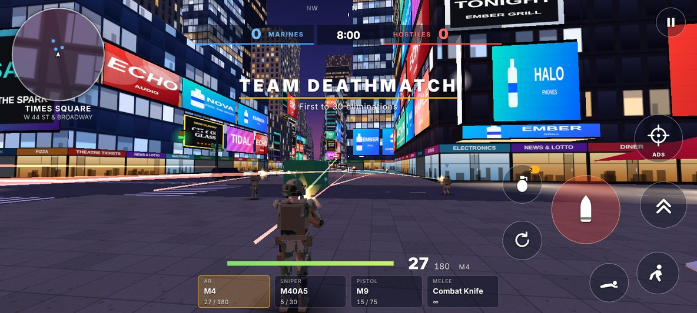
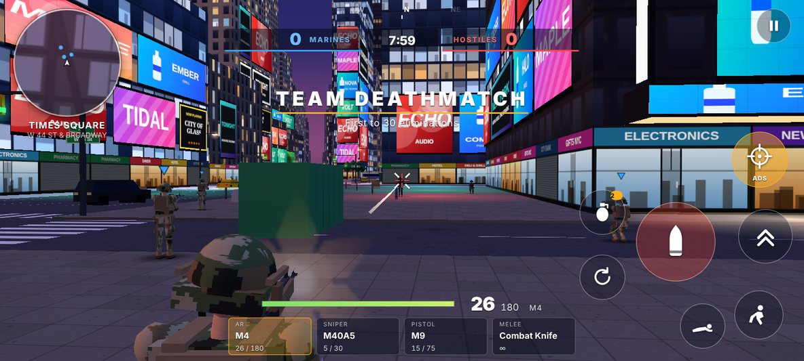
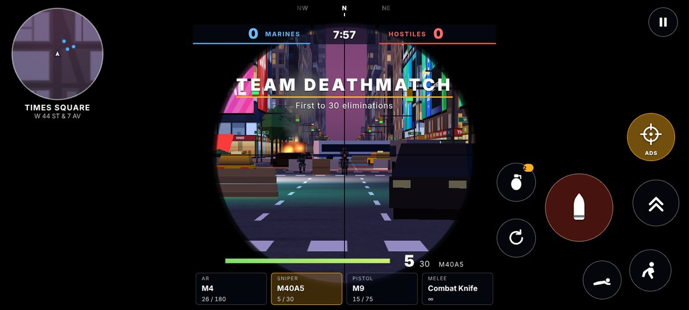
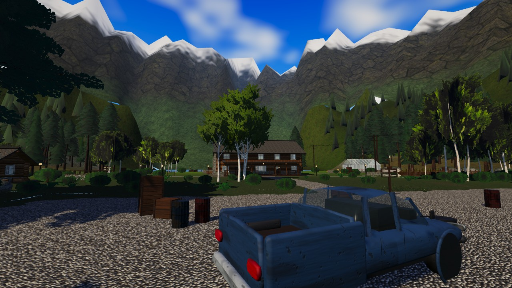
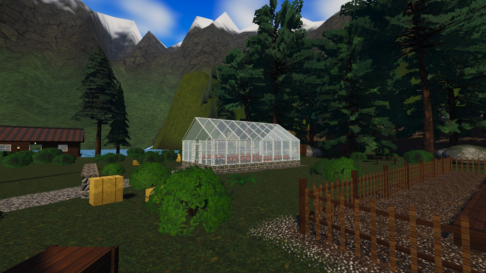

# Midtown Strike

A tactical shooter for Android phones and Mac, playable in third or first person. You play a US
Marine fighting on two maps: a 2-square-mile recreation of Midtown Manhattan built around Times
Square, and Cedar Lodge, a timber lodge on a forested mountain lakeshore.

It is an original game with the feel of a modern mobile military shooter: the movement,
gunplay and touch controls follow the conventions of the genre, while the name, maps and
code are its own. A few models come from Sketchfab under Creative Commons licences; see
[Credits](#credits).



## Install on your phone

1. Copy **[`dist/MidtownStrike.apk`](dist/MidtownStrike.apk)** to the phone (or download it there).
2. Open it. Android asks to allow installs from that app ("unknown sources"). Allow it, then tap **Install**.
3. Play Protect may warn that it does not recognise the developer, because the APK is signed
   with this project's own key rather than a Play Store one. Choose **Install anyway**.

Requirements: Android 7.0 or newer with OpenGL ES 3.0. The APK is about 13 MB. The game runs
offline and needs no network access. Medium graphics is the default on phones; High and Ultra
add sun shadows on every object, bloom and a colour grade.

## Install on a Mac

1. Download **[`dist/MidtownStrike-mac.zip`](dist/MidtownStrike-mac.zip)** and double-click it. You get **Midtown Strike.app**.
2. Drag it into **Applications** (optional) and open it.
3. The first time, macOS says it cannot verify the app, because it is not signed with an Apple
   developer certificate. Click **Done**, open **System Settings → Privacy & Security**, scroll down
   and click **Open Anyway**. On macOS 14 or older, right-click the app and choose **Open** instead.

The app opens the game in its own window when Chrome, Edge or Brave is installed, and in your
default browser (Safari) otherwise. Click **PLAY**. The mouse is captured for aiming, and **Esc**
releases it and pauses. Use the **FULL SCREEN** button in the menu for the best view.

If macOS will not open the app at all, right-click it, choose **Show Package Contents**, and open
`Contents/Resources/game/index.html` in Chrome or Safari: that single file is the whole game.

## What is in the game

| | |
|---|---|
|  |  |
|  |  |

### Maps

**Midtown: 2300 m × 2300 m (2.04 sq mi)**

- The real street plan:
  - 31st to 59th Street and 11th to 3rd Avenue.
  - Broadway cuts the grid diagonally from Herald Square to Columbus Circle, forming the
    Times Square "bowtie" where it crosses 7th Avenue.
- Times Square:
  - walls of animated billboards (all brands invented);
  - the tower with its screen stack, news ticker and New Year's ball;
  - the red steps, theatre marquees, pedestrian plazas and yellow cabs.
- Landmarks to navigate by:
  - Bryant Park and the library, Grand Central, and Rockefeller Plaza with its rink and tree;
  - an Empire-style and a Chrysler-style spire;
  - the arena at Penn Plaza, the pencil towers on 57th, Columbus Circle, the edge of Central
    Park and the Hudson waterfront.
- About 2,600 buildings with PBR facades and detail, 1,700 vehicles, street trees and planters.
  They are generated from a fixed seed, so the city is identical on every device.

**Cedar Lodge: an original 110 m × 130 m map for close 6 v 6 fights**

- A two-storey log lodge with a stone base, a porch, and an enterable interior with a
  fireplace, bar and upstairs gallery.
- Around it:
  - a cabin, a greenhouse with a fenced garden, a tool shed and a woodshed;
  - a boathouse and dock on a lake;
  - a creek with a footbridge and a gravel car park.
- A koi pond with lily pads and ten swimming koi, two weathered school buses used as cover,
  and a phoenix circling the valley.
- Forest and meadow:
  - pines, spruce, birches and maples;
  - shrubs, ferns, wildflowers, reeds and cattails;
  - dense grass that sways in the wind and parts around the player.
- Snow-capped mountains all round, under a clear afternoon sky with sun shadows.
- Everything on this map is built procedurally in Blender (see [Building](#building)).

### The Marine

A scanned tactical soldier (decimated, smooth-skinned to the game's rig, with baked colour,
normal and roughness maps), used for both teams. Hostiles get a darker blue-grey look.

Animation is done in code:
- a foot-planted walk, run and sprint, crouch (kneeling when still), prone and slide;
- jumps and mantling;
- two-handed weapon handling with arm IK onto the grips, in both cameras;
- reloads, melee swings, hit reactions and falls.

### Weapons

You carry one weapon from each class, chosen in the menu:

| Class | Weapons |
|---|---|
| Assault rifle | M4 (auto, holographic sight), AK-47 (auto), M16 (3-round burst) |
| Sniper rifle | KSR-29 (bolt action), M40A5 (bolt action), M107 .50 (semi-auto) |
| Handgun | M1911, M9, .50 GS |
| Melee | Combat Knife, Tomahawk, Longsword |

You also carry frag grenades that bounce and roll.

### Mechanics

- **Camera:** first person or third person; switch at any time.
- **Movement:** walk, sprint, crouch, prone, slide (crouch while sprinting), jump, and mantling
  over cars, barriers and crates.
- **Gunplay:**
  - hitscan ballistics with damage drop-off over range, and head, torso and limb multipliers;
  - hip-fire spread that blooms with movement and sustained fire;
  - aim-down-sights with per-weapon timing and zoom;
  - recoil that climbs and settles;
  - magazines, reserves and timed reloads;
  - scoped sniping and a melee lunge.
- **Health and ammo:** health regenerates out of combat, and eliminations top up ammunition.
- **Touch help:** aim assist and an optional auto-fire ("simple") mode.
- **Bots:**
  - sight cones, hearing and reaction times;
  - burst fire and strafing;
  - snipers and knife rushers;
  - four difficulty levels.
  - They path over a street graph in Midtown and a walkable grid at Cedar Lodge.
- **Photo mode:** freezes the match and lets you fly a camera drone anywhere to take pictures.

### Modes

- **Team Deathmatch, Times Square:** 6 v 6 in the bowtie, first to 30.
- **City Sweep:** an open-world mode. Lead a fire team across all of Midtown and clear nine
  hostile strongpoints. Subway entrances give fast travel and resupply.
- **Team Deathmatch, Cedar Lodge:** 6 v 6 around the lodge, first to 30.

## Controls

The full list is also in the game: the **Controls** tab of the main menu, and **Controls** in the
pause menu.

**Touch**

- Drag on the left half to move; push past the ring to sprint.
- Drag on the right half to look.
- Hold the red button to fire. Keep dragging on it to track a target.
- Buttons for ADS, jump, crouch, prone, reload and grenade.
- Tap a weapon slot to switch weapons, and tap the minimap for the full map.
- **TPP/FPP** switches the camera, and the camera button opens photo mode.

**Keyboard and mouse**

| Key | Action |
|---|---|
| WASD | move |
| Shift | sprint |
| Space | jump |
| C | crouch |
| Z | prone |
| Mouse or trackpad, click | aim, fire |
| Right click (two-finger click) or X | sights |
| R | reload |
| 1–4 or scroll | weapons |
| G | grenade |
| F | interact |
| M | map |
| V | first / third person |
| L | photo mode |
| Esc | pause |

On a trackpad, *Fire mode: Auto* in Settings is easier.

**Photo mode**

| Key | Action |
|---|---|
| WASD | fly |
| Mouse | look |
| Space / E | up |
| C / Q | down |
| Shift | fast |
| Alt | slow |
| Scroll | zoom |
| Click or Enter | save a PNG |
| H | hide the hints |
| L or Esc | leave |

On Android, photos go to the gallery.

## Building

The game is plain JavaScript on [three.js](https://threejs.org), bundled by esbuild into one
self-contained HTML file. The Android app shows that file in a full-screen WebView, and the Mac
app opens it in a browser window.

```bash
npm install
npm run build        # -> android/app/src/main/assets/game/index.html
npm run dev          # rebuild on change, http://localhost:8080
```

`index.html` is self-contained, so opening it in Chrome is the quickest way to try a change.

**APK, without the Android SDK.** This is how `dist/MidtownStrike.apk` is built:

```bash
(cd android/tools && mvn -q dependency:copy-dependencies -DoutputDirectory=lib)   # once
npm run apk          # build + python3 android/build_apk.py
```

`android/build_apk.py` needs only a JDK (17 works), Python 3 and three jars from Maven Central:
`android-4.1.1.4`, `dalvik-dx-16.0.1` and `apksig-2.3.0`, placed in `android/tools/lib`. It does
the whole build itself:
- writes the binary manifest and resource table;
- compiles the activity with `javac`;
- converts it with AOSP `dx`;
- aligns the archive;
- signs it with Google's `apksig` (APK Signature Scheme v2).

If the JDK is Homebrew's keg-only OpenJDK, put it on the path for the build:
`PATH=/opt/homebrew/opt/openjdk@17/bin:$PATH npm run apk`.

**APK, with the Android SDK.** `android/` is also a standard Gradle project
(`cd android && ./gradlew assembleDebug`, or open it in Android Studio).

**The Mac app** is the same HTML file in an app bundle with a small launcher script, so any
operating system can assemble it with Python: `npm run mac` writes `dist/MidtownStrike-mac.zip`.

**Models and assets.** These scripts drive Blender in the background:
`/Applications/Blender.app/Contents/MacOS/Blender --background --python <script>`. They write the
`src/**/*_asset.js` modules, so run them only when a model changes.

| Script | Builds |
|---|---|
| `tools/blender/build_soldier_glb.py` | the soldier, from the scanned source model |
| `tools/blender/build_weapons.py` | the Blender-built rifles, snipers and pistols |
| `tools/blender/import_weapons.py` | the imported M1911, KSR-29 and longsword |
| `tools/blender/build_vehicles.py` | Midtown's street vehicles |
| `tools/blender/build_lodge.py` | Cedar Lodge's terrain, buildings, props, colliders and spawns |
| `tools/blender/build_foliage.py` | trees, impostors, shrubs, ground cover and grass |
| `tools/blender/build_lodge_props.py` | the school buses, koi pond, koi and phoenix |

`tools/recompress_assets.py` then re-encodes the embedded textures to keep the bundle small.
The Cedar Lodge data format is described in `docs/MAP_CONTRACT.md`.

### How this build was checked

- **Browser testing:** the game was driven in Chromium through Playwright:
  - scripted checks of every mechanic;
  - multi-touch input;
  - simulated full matches on both maps;
  - the menu, pause, photo mode and results flow;
  - draw-call and triangle budgets per quality level.
- **APK:** it passes `apksig` verification.
- **Not yet tested:** physical phones, and Safari and Gatekeeper behaviour on a real Mac.

## Credits

Models from Sketchfab, all modified for the game. Full details are in
[`docs/CREDITS.md`](docs/CREDITS.md).

| In game | Model | Author | Licence |
|---|---|---|---|
| M1911 | Colt M1911 | lokeig | CC-BY-NC-4.0 |
| KSR-29 | KSR 29 Sniper | 3DHaupt | CC-BY-NC-4.0 |
| Longsword | Magic sword. | Biomoloko | CC-BY-4.0 |
| Koi | Koi Fish | 7PLUS | CC-BY-4.0 |
| Phoenix | phoenix bird | NORBERTO-3D | CC-BY-4.0 |

Because of the two CC-BY-NC models, builds that contain them are for non-commercial use only.

## Layout

```
src/maps       map registry; Midtown and Cedar Lodge (loading, physics, atmosphere, zones)
src/world      city generator, terrain, foliage, water, pond, buses, nav, textures
src/chars      the soldier: mesh and maps, rig and animation
src/game       scene and lighting, player, bots, weapons, effects, audio, modes
src/ui         HUD and touch controls
tools/blender  Blender scripts that build the models and maps
android/       host activity, Gradle project, SDK-less APK builder
mac/           Mac app bundle: launcher, plist, icon, packer
docs/          screenshots, credits, map contract
dist/          the installable APK and the Mac app
```

This repository is also worked on with the Antigravity IDE. The session handoff log lives in the
`README.md` one folder up, outside the repository.
